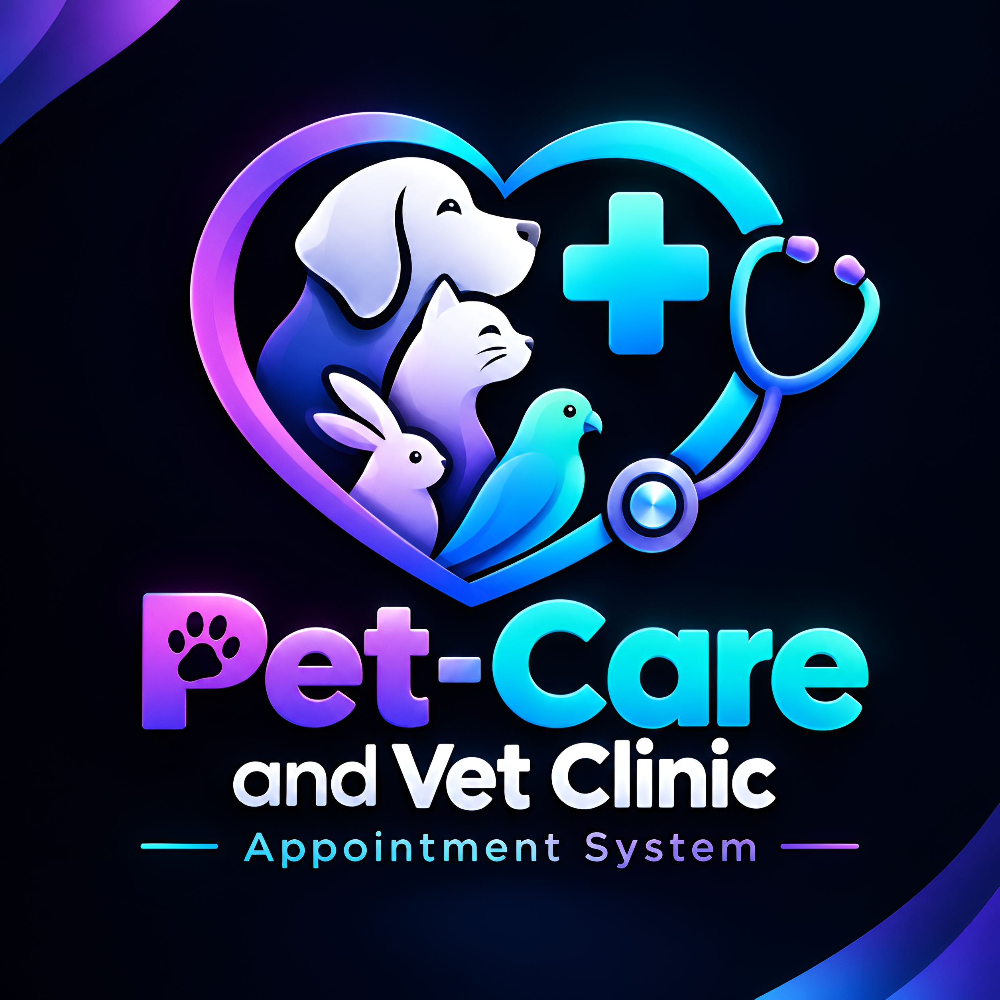
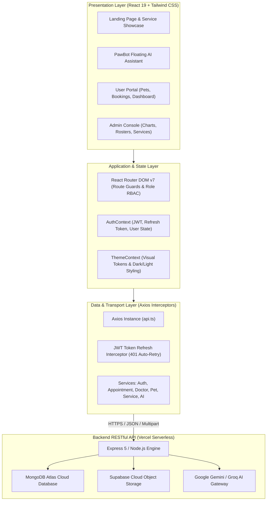
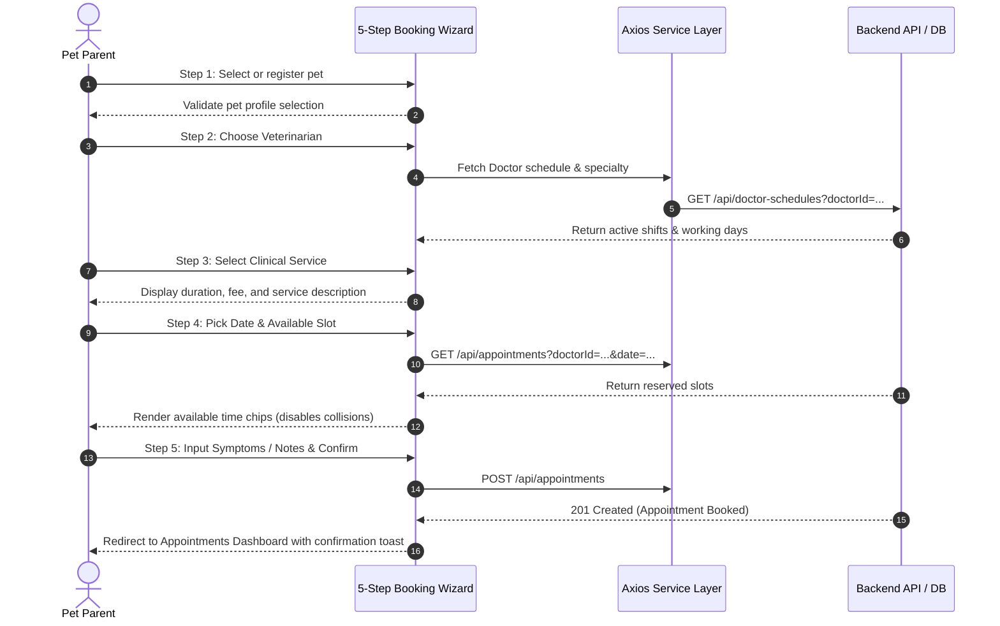

<p align="center">
  
</p>

<h1 align="center">PetCare & Vet Clinic Appointment System — Client Portal</h1>

<p align="center">
  <b>Modern, Responsive Single Page Application (SPA) for Veterinary Healthcare & Clinical Appointment Management</b><br />
  Final Coursework Project for Rapid Application Development (RAD &bull; ITS2020) &bull; IJSE Semester 03
</p>

<p align="center">
  <a href="https://pet-care-and-vet-clinic.vercel.app/"></a>
  <a href="https://pet-care-and-vet-clinic-backend.vercel.app/"></a>
  <a href="https://react.dev/"></a>
  <a href="https://www.typescriptlang.org/"></a>
  <a href="https://vitejs.dev/"></a>
  <a href="https://tailwindcss.com/"></a>
  <a href="https://lucide.dev/"></a>
</p>

---

### 🌐 Hosted Production Deployments

| Component | Target URL | Status | Description |
| :--- | :--- | :---: | :--- |
| **Client & Admin Web Application** | [https://pet-care-and-vet-clinic.vercel.app/](https://pet-care-and-vet-clinic.vercel.app/) |  | React 19 SPA, Tailwind CSS, Lucide Icons, interactive workflows |
| **Backend RESTful API** | [https://pet-care-and-vet-clinic-backend.vercel.app/](https://pet-care-and-vet-clinic-backend.vercel.app/) |  | Express 5 engine on Vercel Node runtime |
| **Backend Base API Route** | `https://pet-care-and-vet-clinic-backend.vercel.app/api` |  | CORS configured for production frontend origin |

#### 🔑 Pre-Configured Evaluation Credentials

For academic grading, peer review, and live feature demonstration, pre-seeded accounts are provided below:

| Account Type | Email | Password | Available Privileges |
| :--- | :--- | :--- | :--- |
| **Clinic Administrator** | `admin@petcare.com` | `admin123` | Analytics dashboard, doctor schedules, clinical service catalog, appointment management |
| **Pet Parent (Client)** | `user@petcare.com` | `user123` | Pet profiles, 5-stage booking wizard, booking history, personal dashboard |

> *Self-service registration is also available with real-time field validation, secure password hashing, and automated email notifications.*

---

## 📋 Table of Contents

- [Overview & Problem Context](#-overview--problem-context)
- [System Architecture](#-system-architecture)
- [Key Features & Portals](#-key-features--portals)
  - [1. Pet Parent (Client) Portal](#1-pet-parent-client-portal)
  - [2. Interactive 5-Step Appointment Booking Engine](#2-interactive-5-step-appointment-booking-engine)
  - [3. PawBot — Real-Time Veterinary AI Assistant](#3-pawbot--real-time-veterinary-ai-assistant)
  - [4. Clinic Administration & Operations Suite](#4-clinic-administration--operations-suite)
  - [5. Zero-Dependency SVG Data Visualizations](#5-zero-dependency-svg-data-visualizations)
  - [6. Authentication & Token Lifecycle Management](#6-authentication--token-lifecycle-management)
- [Application Route Map](#-application-route-map)
- [Technology Stack](#-technology-stack)
- [Directory Structure](#-directory-structure)
- [Local Setup & Development Guide](#-local-setup--development-guide)
  - [Prerequisites](#prerequisites)
  - [Step-by-Step Installation](#step-by-step-installation)
  - [Environment Variables](#environment-variables)
- [Build & Production Deployment](#-build--production-deployment)
- [Academic Metadata](#-academic-metadata)

---

## 📌 Overview & Problem Context

In standard veterinary clinics, appointment scheduling and record tracking are typically conducted through traditional paper logbooks or scattered phone calls. This results in severe scheduling friction: double-booked consultation slots, unclear doctor shift hours, miscommunicated patient histories, and client frustration over wait times.

The **PetCare & Vet Clinic Frontend Portal** is a production-ready, client-facing single-page application built to solve these bottlenecks. Designed with modern user experience principles, the system provides:
1. **Frictionless Booking**: A guided 5-step wizard that dynamically filters available time slots against actual veterinarian shift rotas, eliminating double-bookings at the source.
2. **Comprehensive Pet Health Records**: Allows pet parents to maintain structured medical profiles, vaccination notes, and species-specific information.
3. **Veterinary AI Triage**: An embedded floating AI assistant (*PawBot*) that offers instant pet health advice and directs pet owners toward suitable clinic services.
4. **Administrative Command Center**: A clean, responsive management console featuring custom data charts, doctor roster scheduling, service pricing adjustments, and full booking lifecycles.

---

## 🏗 System Architecture

The frontend is architected as a decoupled React 19 Single Page Application communicating over HTTPS with the Express 5 REST API:



---

## 🚀 Key Features & Portals

### 1. Pet Parent (Client) Portal
- **Immersive Landing Page**: Hero section with interactive live particle canvas (`HeroLiveBackground.tsx`), animated veterinary specialists grid, clinic service offerings, and trust signals.
- **Patient Profile Management (`UserPets.tsx`)**: Register pets with details including name, species (Dog, Cat, Bird, Exotic), breed, age, gender, medical history notes, and photo avatars.
- **Personalized Dashboard (`UserDashboard.tsx`)**: Quick access to upcoming appointments, registered pet cards, quick action links, and real-time status notices.
- **Appointment History & Status Tracking (`UserAppointments.tsx`)**: Categorized view of appointments across lifecycle stages (`Pending`, `Confirmed`, `Completed`, `Cancelled`) with one-click cancellation workflows.

---

### 2. Interactive 5-Step Appointment Booking Engine

The core booking workflow (`UserBookAppointment.tsx`) is structured into five sequential, validated steps designed to prevent booking mistakes:



1. **Step 1 — Patient Selection**: Pick an existing registered pet or create a new pet profile inline without leaving the booking flow.
2. **Step 2 — Doctor Selection**: Filter specialists by discipline (General Practice, Veterinary Surgery, Canine Care, Dermatology, Dentistry).
3. **Step 3 — Treatment Selection**: Select from standardized clinic services with clear pricing, consultation durations, and scope.
4. **Step 4 — Schedule & Time Slot Picker**: Dynamic calendar checks the selected doctor's shift schedule (working days and hours) and queries existing bookings to prevent double-booking conflicts.
5. **Step 5 — Symptoms & Confirmation**: Add notes regarding symptoms or allergies, review a comprehensive booking summary, and submit.

---

### 3. PawBot — Real-Time Veterinary AI Assistant

- **Persistent Floating Widget (`PetChatBot.tsx`)**: Accessible across all pages via a floating action trigger with interactive pet animations (`puppy_gif.gif`).
- **Context-Aware Veterinary Triage**: Integrated with the backend AI service (`/api/ai/chat`), backed by Google GenAI (Gemini) and Groq LLMs.
- **Pre-Consultation Advice**: Answers urgent pet care questions (e.g., diet restrictions, toxic foods, initial emergency indicators) and guides pet owners to appropriate clinic services.
- **Interactive UI**: Supports instant markdown rendering, collapsible chat panels, and smooth scroll handling.

---

### 4. Clinic Administration & Operations Suite

- **Executive Analytics Dashboard (`AdminDashboardPage.tsx`)**: High-level KPI metric cards tracking total volume, active pets, active veterinarians, and gross revenue.
- **Doctor Roster & Shifts (`AdminDoctors.tsx`, `DoctorScheduleModal.tsx`)**: Add new veterinarians, update clinical qualifications, and configure recurring weekly working days and hours with capacity controls.
- **Service Catalog Management (`AdminServices.tsx`)**: Maintain medical procedures, routine treatments, pricing tiers, and estimated appointment durations.
- **Centralized Appointment Desk (`AdminAppointments.tsx`)**: Comprehensive table with search by owner/doctor/pet name, date filtering, status indicators, and immediate status transitions (`Confirm`, `Complete`, `Cancel`).
- **All Patients Directory (`AdminPets.tsx`)**: Searchable global directory of registered animals, linking each pet to its owner's contact details and clinical notes.

---

### 5. Zero-Dependency SVG Data Visualizations

To avoid the overhead of heavy third-party charting libraries, the admin analytics dashboard uses lightweight, responsive SVG charts built directly with React and Tailwind CSS:

| Chart Component | File | Purpose |
| :--- | :--- | :--- |
| **Area Trend Chart** | `src/components/charts/AreaChart.tsx` | Visualizes appointment booking trends and patient intake over time. |
| **Bar Distribution Chart** | `src/components/charts/BarChart.tsx` | Displays monthly consultation volume comparisons. |
| **Donut Status Chart** | `src/components/charts/DonutChart.tsx` | Shows proportional breakdown of appointment statuses (Pending vs. Confirmed vs. Cancelled). |

---

### 6. Authentication & Token Lifecycle Management

- **Centralized Session Context (`AuthContext.tsx`)**: Tracks user identity, role array (`['USER']`, `['ADMIN']`), and authentication flags across the application.
- **Silent JWT Refresh Interceptor (`src/service/api.ts`)**:
  - Automatically attaches `Bearer <ACCESS_TOKEN>` to outbound HTTP requests.
  - Intercepts `401 Unauthorized` responses and issues a silent refresh request using the stored `REFRESH_TOKEN`.
  - Upon successful rotation, updates local storage, re-attaches the new token, and replays the original failed request without user interruption.
  - Automatically clears credentials and redirects to `/login` if refresh fails or the refresh token expires.
- **Role-Based Protected Routes (`src/router/index.tsx`)**: `RequireAuth` wrapper protects private routes and enforces role checks (e.g., blocking non-admin users from `/admin/*`).

---

## 🗺 Application Route Map

| Path | Access Level | Component | Purpose |
| :--- | :---: | :--- | :--- |
| `/` | Public | `Home.tsx` | Main clinic landing page, hero, services, and team showcase |
| `/login` | Public (Guest) | `Login.tsx` | User & Admin credentials login |
| `/register` | Public (Guest) | `Register.tsx` | Self-registration for new pet parents |
| `/forgot-password`| Public (Guest) | `ForgotPassword.tsx` | Password recovery via email OTP & reset link |
| `/user/dashboard` | Authenticated | `UserDashboard.tsx` | Overview of pet parent's pets and upcoming appointments |
| `/user/pets` | Authenticated | `UserPets.tsx` | Pet registry, profile editing, and health notes |
| `/user/book` | Authenticated | `UserBookAppointment.tsx` | Interactive 5-step veterinary booking wizard |
| `/user/appointments` | Authenticated | `UserAppointments.tsx` | Personal appointment history and status management |
| `/admin/dashboard`| Admin Only | `AdminDashboardPage.tsx`| Clinic KPI metrics and SVG data charts |
| `/admin/appointments`| Admin Only | `AdminAppointments.tsx` | Clinic appointment desk and status updates |
| `/admin/doctors` | Admin Only | `AdminDoctors.tsx` | Veterinarian directory and shift schedule modal |
| `/admin/services`| Admin Only | `AdminServices.tsx` | Clinic treatments, consultation fees, and services catalog |
| `/admin/pets` | Admin Only | `AdminPets.tsx` | Global clinic pet database and patient records |

---

## 💻 Technology Stack

| Domain | Technology / Library | Version | Role in Project |
| :--- | :--- | :---: | :--- |
| **Core Framework** | React | `^19.2.8` | Component-based user interface architecture |
| **Language** | TypeScript | `~6.0.2` | Static typing, interface definitions, and type safety |
| **Build Tooling** | Vite | `^8.3.0` | Ultra-fast local development server and optimized production bundling |
| **Styling & Design** | Tailwind CSS | `^3.4.19` | Utility-first responsive design, dark-mode tones, and custom animations |
| **CSS Preprocessor** | PostCSS & Autoprefixer | `^8.5.29` | Cross-browser CSS compatibility and transformation pipeline |
| **Routing** | React Router DOM | `^7.18.4` | Declarative client-side routing and protected route guards |
| **HTTP Client** | Axios | `^1.20.0` | Promise-based HTTP client with request/response interceptors |
| **Iconography** | Lucide React | `^1.54.0` | Consistent, lightweight SVG iconography |
| **UI Notifications**| React Hot Toast | `^2.6.1` | Sleek, non-blocking toast notifications for user interactions |
| **Hosting Platform**| Vercel | Global CDN | Production continuous deployment and SPA edge routing |

---

## 📁 Directory Structure

```text
ITS2020-Pet-Care-and-Vet-Clinic-Appointment-System-Frontend/
├── public/
│   ├── hero-vet-family.jpg        # Public fallback images
│   ├── pet-care-web-logo.png      # Application favicon & brand icon
│   └── petcare-home-bg.png        # Background visual assets
├── src/
│   ├── assets/                    # Project brand assets
│   │   ├── cat_gif.gif            # Interactive animation
│   │   ├── hero-banner-new.jpg    # High-resolution hero image
│   │   ├── hero-vet-family.jpg    # Clinic doctors & family showcase
│   │   ├── pet-care-logo.png      # Original high-res logo
│   │   ├── pet-care-web-logo.png  # Web-optimized clinic logo
│   │   └── puppy_gif.gif          # PawBot AI animated mascot
│   ├── components/                # Modular reusable UI components
│   │   ├── charts/                # Zero-dependency SVG data charts
│   │   │   ├── AreaChart.tsx      # Booking trends over time
│   │   │   ├── BarChart.tsx       # Monthly volume comparisons
│   │   │   └── DonutChart.tsx     # Appointment status distribution
│   │   ├── modals/                # Contextual modal dialogs
│   │   │   ├── DoctorModal.tsx    # Add / edit doctor details
│   │   │   ├── DoctorScheduleModal.tsx # Manage shifts & slot capacities
│   │   │   └── PetModal.tsx       # Pet creation & profile modal
│   │   ├── CTASection.tsx         # Call-to-action banner
│   │   ├── Footer.tsx             # Global application footer
│   │   ├── HeroLiveBackground.tsx # Interactive background particle canvas
│   │   ├── HeroSection.tsx        # Hero banner with primary action triggers
│   │   ├── Navbar.tsx             # Navigation bar with user/admin state & menu
│   │   ├── PetBookingWorkflow.tsx # 4-step informational visual workflow
│   │   ├── PetChatBot.tsx         # PawBot floating AI assistant widget
│   │   ├── ServicesSection.tsx    # Clinic service cards showcase
│   │   ├── VetsSection.tsx        # Doctor directory carousel / cards
│   │   └── WhyChooseUs.tsx        # Value proposition feature matrix
│   ├── context/                   # Global React Context providers
│   │   ├── AuthContext.tsx        # Authentication state, login/logout, tokens
│   │   └── ThemeContext.tsx       # Theme token controls
│   ├── hooks/                     # Custom React hooks
│   │   └── useAuth.ts             # Auth consumer hook
│   ├── layouts/                   # Layout wrappers
│   │   └── DashboardLayout.tsx    # User and Admin sidebar/topbar shell
│   ├── pages/                     # Routed view components
│   │   ├── admin/                 # Administrator portal views
│   │   │   ├── AdminAppointments.tsx
│   │   │   ├── AdminDashboardPage.tsx
│   │   │   ├── AdminDoctors.tsx
│   │   │   ├── AdminPets.tsx
│   │   │   └── AdminServices.tsx
│   │   ├── user/                  # Pet parent portal views
│   │   │   ├── UserAppointments.tsx
│   │   │   ├── UserBookAppointment.tsx
│   │   │   ├── UserDashboard.tsx
│   │   │   └── UserPets.tsx
│   │   ├── ForgotPassword.tsx     # Password recovery & reset screen
│   │   ├── Home.tsx               # Main public landing page
│   │   ├── Login.tsx              # User & admin login form
│   │   └── Register.tsx           # New pet parent registration form
│   ├── router/
│   │   └── index.tsx              # Route definitions & RequireAuth guard
│   ├── service/                   # API service integration layer
│   │   ├── ai.service.ts          # AI chat endpoints (/ai/chat)
│   │   ├── api.ts                 # Axios instance with interceptors
│   │   ├── appointment.service.ts # Appointment endpoints
│   │   ├── auth.ts                # Authentication endpoints & token refresh
│   │   ├── doctor.service.ts      # Doctor & schedule endpoints
│   │   ├── pet.service.ts         # Pet CRUD endpoints
│   │   └── service.service.ts     # Clinic service catalog endpoints
│   ├── types/                     # TypeScript data interfaces & types
│   │   ├── appointment.types.ts
│   │   ├── auth.types.ts
│   │   ├── doctor.types.ts
│   │   ├── pet.types.ts
│   │   └── service.types.ts
│   ├── App.tsx                    # Root application entry
│   ├── index.css                  # Tailwind styles and custom utilities
│   └── main.tsx                   # DOM mounting with StrictMode
├── .env.example                   # Sample environment variable template
├── index.html                     # HTML5 entry template
├── package.json                   # Project scripts and dependencies
├── tailwind.config.js             # Tailwind CSS configuration & theme extensions
├── tsconfig.json                  # TypeScript workspace configuration
└── vite.config.ts                 # Vite bundler configuration
```

---

## ⚙️ Local Setup & Development Guide

### Prerequisites

Ensure you have the following installed on your local workstation:
- **Node.js**: `v18.0.0` or higher (Node `v20.x` recommended)
- **Package Manager**: `npm` (v9+), `pnpm`, or `yarn`
- **Backend Service**: Either running the [Backend Repository](https://pet-care-and-vet-clinic-backend.vercel.app/) locally or pointing to the live hosted API.

---

### Step-by-Step Installation

#### 1. Clone the Repository
```bash
git clone https://github.com/chathunga2007/ITS2020-Pet-Care-and-Vet-Clinic-Appointment-System-Frontend.git
cd ITS2020-Pet-Care-and-Vet-Clinic-Appointment-System-Frontend
```

#### 2. Install Project Dependencies
```bash
npm install
```

#### 3. Configure Environment Variables
Create a local `.env` file in the root directory by duplicating `.env.example`:

```bash
# On Windows PowerShell
Copy-Item .env.example .env

# On Linux / macOS
cp .env.example .env
```

Set the `VITE_API_BASE_URL` to your target API endpoint:

```env
# For local backend development
# VITE_API_BASE_URL=http://localhost:3000/api

# For live hosted production backend
VITE_API_BASE_URL=https://pet-care-and-vet-clinic-backend.vercel.app/api
```

#### 4. Start the Development Server
```bash
npm run dev
```

The application will launch with Hot Module Replacement (HMR) at:
```text
http://localhost:5173/
```

---

### Environment Variables

| Variable Name | Required | Default Value | Description |
| :--- | :---: | :--- | :--- |
| `VITE_API_BASE_URL` | **Yes** | `http://localhost:3000/api` | Base URL of the backend RESTful API where all requests are routed. |

---

## 📦 Build & Production Deployment

### Production Compilation

To compile TypeScript and build an optimized production bundle:

```bash
npm run build
```

This executes `tsc -b` for strict type verification followed by `vite build`. The bundled output is generated inside the `dist/` directory, optimized with minified JavaScript, chunk splitting, and hashed assets for long-term browser caching.

To test the compiled production build locally:

```bash
npm run preview
```

### Vercel Deployment

The application is deployed on **Vercel** with single-page application rewriting enabled. When deploying to Vercel:
1. Connect the GitHub repository to your Vercel project.
2. Set the **Framework Preset** to `Vite`.
3. Set the **Build Command** to `npm run build` and **Output Directory** to `dist`.
4. Configure the Environment Variable:
   - `VITE_API_BASE_URL`: `https://pet-care-and-vet-clinic-backend.vercel.app/api`
5. Deploy. All client-side route transitions (e.g., `/user/book`, `/admin/dashboard`) will resolve seamlessly via Vercel's edge network.

---

## 🎓 Academic Metadata

- **Institution**: [Institute of Software Engineering (IJSE)](https://www.ijse.lk/)
- **Program**: Graduate Diploma in Software Engineering (GDSE) / Higher National Diploma
- **Semester**: Semester 03
- **Module**: Rapid Application Development (RAD &bull; Module ITS2020)
- **Project**: Pet Care and Veterinary Clinic Online Consultation & Appointment Scheduling System
- **Repository (Frontend)**: [ITS2020-Pet-Care-and-Vet-Clinic-Appointment-System-Frontend](https://github.com/chathunga2007/ITS2020-Pet-Care-and-Vet-Clinic-Appointment-System-Frontend)
- **Repository (Backend)**: [ITS2020-Pet-Care-and-Vet-Clinic-Appointment-System-Backend](https://github.com/chathunga2007/ITS2020-Pet-Care-and-Vet-Clinic-Appointment-System-Backend)

---

<p align="center">
  <b>PetCare & Vet Clinic</b> &bull; Engineering seamless healthcare management for pets and their companions. 🐾
</p>