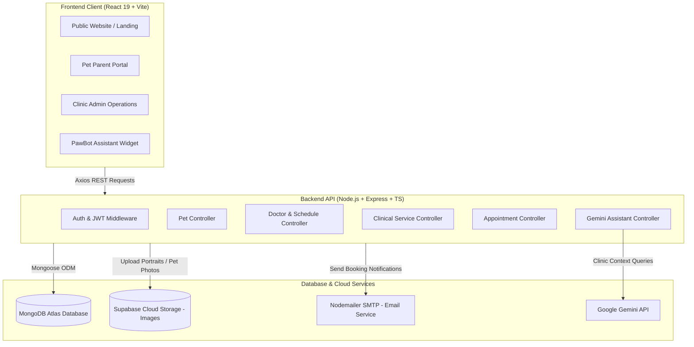
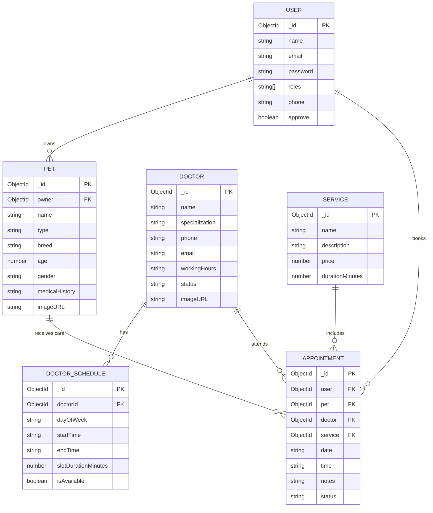

<p align="center">
  
</p>

<h1 align="center">PetCare & Vet Clinic</h1>
<h3 align="center">Online Appointment Booking & Veterinary Clinical Management System</h3>

<p align="center">
  A production-ready, full-stack veterinary clinic management platform designed to streamline patient onboarding, veterinary doctor shift scheduling, multi-step appointment booking, and client communication.
</p>

<p align="center">
  <a href="https://pet-care-and-vet-clinic.vercel.app/"></a>
  <a href="https://pet-care-and-vet-clinic-backend.vercel.app/"></a>
  
  
  
  
  
  
</p>

---

## 📌 Project Overview

**PetCare & Vet Clinic** is developed as the Final Coursework for **Rapid Application Development (RAD - ITS2020)** in **Semester 03** at the **Institute of Software Engineering (IJSE)**. 

Veterinary practices frequently face challenges with traditional manual bookings: overlapping slots, lack of structured pet medical histories, unoptimized doctor consulting hours, and slow communication with pet parents. This system resolves those issues through a centralized cloud application with distinct **Client (Pet Parent)** and **Administrative (Clinic Staff)** portals, automated email confirmations, and an intelligent clinic assistant.

### 🔗 Live Deployments

| Resource | URL |
| :--- | :--- |
| **Frontend Web App** | [https://pet-care-and-vet-clinic.vercel.app/](https://pet-care-and-vet-clinic.vercel.app/) |
| **Backend REST API** | [https://pet-care-and-vet-clinic-backend.vercel.app/](https://pet-care-and-vet-clinic-backend.vercel.app/) |

---

## ✨ Key System Features

### 🐾 1. Pet Parent (Client) Portal
- **Secure Authentication**: JWT-based authentication with bcrypt password hashing and persistent sessions.
- **Pet Registry Management**:
  - Register pets with category (Dog, Cat, Bird, Rabbit, etc.), breed, age, and gender.
  - Image upload with automatic cloud storage on Supabase CDN.
  - Maintain ongoing medical notes and health backgrounds for each pet.
- **5-Step Interactive Appointment Wizard**:
  1. *Step 1 — Select Pet*: Choose from registered family pets or add a new one on the fly.
  2. *Step 2 — Select Veterinarian*: Pick an active doctor based on specialization.
  3. *Step 3 — Select Clinical Service*: Choose from clinic services (e.g., Wellness Exam, Dental Scaling, Surgery, Vaccination) with standard pricing and duration.
  4. *Step 4 — Real-Time Slot Picker*: Choose an available date; the system automatically calculates available consulting time slots according to the doctor's active weekly roster.
  5. *Step 5 — Review & Confirm*: Overview of booking details, service fee (LKR), and optional special care instructions.
- **Appointment Tracking**: Live view of upcoming and past consultations with status badges (`PENDING`, `CONFIRMED`, `COMPLETED`, `CANCELLED`).
- **Automated Email Notifications**: Instant transactional confirmation emails sent upon booking via Nodemailer.

---

### 🩺 2. Clinic Operations (Admin) Portal
- **Administrative Dashboard**: Real-time counts of total appointments, registered doctors, active clinic services, and registered pets.
- **Specialist & Doctor Management**:
  - Register new veterinarians with photo portraits, contact details, email, and clinical specialization.
  - Toggle doctor active status on the clinic floor.
- **Doctor Working Schedule Roster**:
  - Configure daily consulting hours for each day of the week (Monday through Sunday).
  - Configurable consultation slot intervals (15, 30, 45, or 60 minutes).
  - 1-Click *"Standard Weekday Preset"* for rapid scheduling.
- **Clinical Services Directory**:
  - Register, update, and manage medical services and clinical procedures.
  - Set standard consultation fees (LKR), slot duration requirements, and preparation guidelines.
- **Appointment Lifecycle Dispatcher**:
  - Filter appointments by status or search by pet/owner name.
  - Confirm bookings, mark consultations completed, or cancel with automatic client notification.
- **Pet Patient Directory**: System-wide view of all registered pets and their medical records.

---

### 🤖 3. PawBot — Virtual Clinic Assistant
- Real-time conversational assistant integrated into the platform to guide pet owners 24/7.
- Grounded in clinic database context (available veterinary specialists, duty timetables, pricing for clinical services, and general pet wellness care).
- Built-in quick inquiry prompts, responsive floating card layout, and live typing indicators.

---

### 🎨 4. Modern UI & Glassmorphic Design
- **Theme Support**: Full Light Mode & Dark Mode with immediate local persistence.
- **Portal Modals**: High-performance React Portals (`createPortal`) mounting directly to `document.body` with deep `backdrop-blur-md` frosted glass overlays and background scroll lock.
- **Responsive Layout**: Mobile-first architecture supporting desktop, tablet, and mobile devices.

---

## 🏗️ System Architecture



---

## 💻 Tech Stack

### Frontend
| Technology | Description |
| :--- | :--- |
| **React 19** | Modern component-based user interface library |
| **TypeScript** | Type-safe enterprise JavaScript |
| **Vite** | Fast Next-Gen frontend build tooling |
| **Tailwind CSS** | Utility-first CSS framework with custom medical teal theme |
| **React Router v7** | Declarative client-side routing and protected routes |
| **Lucide React** | Clean, lightweight icon suite |
| **Axios** | Promise-based HTTP client with request/response interceptors |
| **React Hot Toast** | Minimalist toast notifications |

### Backend
| Technology | Description |
| :--- | :--- |
| **Node.js & Express** | Server-side JavaScript runtime and RESTful API framework |
| **TypeScript** | Strict typing for models, controllers, and services |
| **MongoDB & Mongoose** | Cloud NoSQL database with schema validation and population |
| **JWT (JSON Web Tokens)** | Stateless token-based user authentication and RBAC |
| **Supabase Storage** | Cloud bucket storage for pet photos and doctor portraits |
| **Nodemailer** | SMTP email client for appointment alerts and status updates |
| **Google Gemini API** | Natural language processing for the clinic assistant |
| **Multer** | Multipart form-data handling for file uploads |

---

## 🗄️ Database Schema Overview



---

## 📡 REST API Reference

### 🔐 Authentication (`/api/auth`)
| Method | Endpoint | Access | Description |
| :--- | :--- | :--- | :--- |
| `POST` | `/register` | Public | Register a new user profile |
| `POST` | `/login` | Public | Authenticate user & return JWT token |
| `GET` | `/me` | User / Admin | Get current authenticated user profile |

### 🐶 Pet Management (`/api/pets`)
| Method | Endpoint | Access | Description |
| :--- | :--- | :--- | :--- |
| `POST` | `/` | User | Register a new pet (with photo upload) |
| `GET` | `/my-pets` | User | Get all pets belonging to logged-in user |
| `GET` | `/` | Admin | Get all pets registered in the clinic |
| `PUT` | `/:id` | User / Admin | Update pet profile |
| `DELETE`| `/:id` | User / Admin | Remove a pet record |

### 🩺 Doctors (`/api/doctors`)
| Method | Endpoint | Access | Description |
| :--- | :--- | :--- | :--- |
| `GET` | `/` | Public | Get list of all active doctors |
| `POST` | `/` | Admin | Add new doctor with photo upload |
| `PUT` | `/:id` | Admin | Update doctor credentials |
| `DELETE`| `/:id` | Admin | Delete doctor profile |

### 📅 Doctor Schedules (`/api/doctor-schedules`)
| Method | Endpoint | Access | Description |
| :--- | :--- | :--- | :--- |
| `GET` | `/:doctorId` | Public | Get weekly timetable for a doctor |
| `POST` | `/` | Admin | Set/update duty hours and slot duration for a weekday |

### 💉 Clinical Services (`/api/services`)
| Method | Endpoint | Access | Description |
| :--- | :--- | :--- | :--- |
| `GET` | `/` | Public | List all available clinical procedures & pricing |
| `POST` | `/` | Admin | Create a new service |
| `PUT` | `/:id` | Admin | Update service price, duration, or details |
| `DELETE`| `/:id` | Admin | Remove a clinical service |

### 📋 Appointments (`/api/appointments`)
| Method | Endpoint | Access | Description |
| :--- | :--- | :--- | :--- |
| `POST` | `/` | User | Book a new consultation slot |
| `GET` | `/my-appointments` | User | Get appointments booked by current user |
| `GET` | `/` | Admin | Get all clinic appointments |
| `PUT` | `/:id/status` | Admin | Update status (`CONFIRMED`, `COMPLETED`, `CANCELLED`) |

### 🤖 Assistant (`/api/ai`)
| Method | Endpoint | Access | Description |
| :--- | :--- | :--- | :--- |
| `POST` | `/chat` | Public | Send inquiry to PawBot assistant with clinic context |

---

## 🚀 Getting Started Locally

### Prerequisites
- **Node.js** (v18.0 or later)
- **npm** or **pnpm**
- **MongoDB** (Local instance or MongoDB Atlas cluster connection string)
- **Supabase Account** (For image bucket storage)

---

### 1. Backend Setup

```bash
# Navigate to the backend directory
cd ITS2020-Pet-Care-and-Vet-Clinic-Appointment-System-Backend

# Install dependencies
npm install

# Create environment configuration
cp .example.env .env
```

Configure your `.env` file with your credentials:
```env
PORT=3000
MONGO_LOCAL_URL=mongodb+srv://<username>:<password>@cluster0.mongodb.net/petcare-clinic
JWT_SECRET=your_jwt_secret_key_here
JWT_REFRESH_SECRET=your_refresh_secret_here

# Supabase Storage Configuration
SUPERBASE_URL=https://your-project.supabase.co
SUPERBASE_KEY=your_supabase_service_role_key

# Nodemailer SMTP Configuration
EMAIL_HOST=smtp.gmail.com
EMAIL_PORT=587
EMAIL_USER=your_clinic_email@gmail.com
EMAIL_PASS=your_gmail_app_password

# Google Gemini API Key
GEMINI_API_KEY=your_gemini_api_key_here
```

Start the development backend server:
```bash
npm run dev
# Server will run at http://localhost:3000
```

---

### 2. Frontend Setup

```bash
# Navigate to the frontend directory
cd ITS2020-Pet-Care-and-Vet-Clinic-Appointment-System-Frontend

# Install dependencies
npm install

# Create environment configuration
cp .env.example .env
```

Configure your `.env` file:
```env
# Point to your local or deployed backend
VITE_API_BASE_URL=http://localhost:3000/api
# Or use the live backend:
# VITE_API_BASE_URL=https://pet-care-and-vet-clinic-backend.vercel.app/api
```

Start the frontend development server:
```bash
npm run dev
# Application will launch at http://localhost:5173
```

---

## 🧪 Demo Test Accounts

For evaluation and testing purposes, you can use the following pre-configured credentials:

| Role | Email | Password | Access Scope |
| :--- | :--- | :--- | :--- |
| **Administrator** | `admin@petcare.com` | `admin123` | Complete Administrative Operations, Doctor Rosters, Services & Appointments |
| **Pet Parent (User)** | `user@petcare.com` | `user123` | Client Dashboard, Pet Registry, 5-Step Appointment Booking |

*(You can also register a fresh account anytime directly via the [Sign Up page](https://pet-care-and-vet-clinic.vercel.app/register).)*

---

## 📂 Project Structure

```
├── ITS2020-Pet-Care-and-Vet-Clinic-Appointment-System-Frontend/
│   ├── src/
│   │   ├── assets/              # Clinic logos, banners, animal mascot animations
│   │   ├── components/          # Reusable UI components (Navbar, Hero, PawBot, Footer)
│   │   │   └── modals/          # Doctor, Schedule, and Pet Portal Modals
│   │   ├── context/             # AuthContext, ThemeContext (Light/Dark)
│   │   ├── hooks/               # Custom hooks (useAuth, useTheme)
│   │   ├── layouts/             # DashboardLayout (Sidebar, Top Navigation)
│   │   ├── pages/               # Application Views
│   │   │   ├── admin/           # AdminDashboard, AdminDoctors, AdminServices, AdminPets, AdminAppointments
│   │   │   ├── user/            # UserDashboard, UserPets, UserBookAppointment, UserAppointments
│   │   │   ├── Home.tsx         # Public Landing Page
│   │   │   ├── Login.tsx        # Authentication Login
│   │   │   └── Register.tsx     # Authentication Registration
│   │   ├── router/              # Route definitions & Role-based guards
│   │   ├── service/             # Axios API integration modules
│   │   ├── types/               # TypeScript interface declarations
│   │   └── utils/               # SweetAlert, helper utilities
│   ├── index.html
│   ├── package.json
│   ├── tailwind.config.js
│   └── vite.config.ts
│
└── ITS2020-Pet-Care-and-Vet-Clinic-Appointment-System-Backend/
    ├── src/
    │   ├── config/              # Supabase client initialization
    │   ├── controllers/         # Request handling logic for all entities
    │   ├── middleware/          # JWT auth, role validation, multer upload
    │   ├── models/              # Mongoose schema definitions
    │   ├── routes/              # Express API routers
    │   ├── services/            # Supabase upload, email, AI assistant services
    │   ├── util/                # JWT token helpers
    │   └── index.ts             # Server entry point
    ├── package.json
    └── tsconfig.json
```

---

## 👨‍💻 Author & Acknowledgements

- **Developer**: Chathunga Bimsara
- **Institute**: [Institute of Software Engineering (IJSE)](https://www.ijse.lk/)
- **Course**: Software Engineering — Semester 03
- **Module**: Rapid Application Development (RAD - ITS2020) Final Coursework Project

---

<p align="center">
  <b>PetCare & Vet Clinic Appointment System</b> • Crafted with care for veterinary professionals and loving pet parents.
</p>